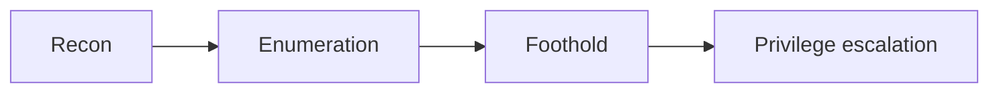

# Building a Great Writeup & Education Blog

A practical guide for turning this site into a blog that people actually want to
read, trust, and come back to.

This guide focuses on **content, structure, and process**. For installation,
configuration, icons, comments, and deployment, see
[GUIDE.md](GUIDE.md).

---

## 1. Decide what the blog is for

A great blog is not a pile of posts. It has a clear promise.

Finish these sentences:

- **Who is it for?** Beginners, intermediate learners, peers, or potential employers?
- **What will they get?** Walkthroughs, explanations, reproducible labs, tool notes?
- **Why should they trust you?** You show your work, test your commands, and explain failures.

Write your answer down. Every post should fit that promise.

A useful default for this site:

> I help people learn security by publishing clear, reproducible writeups and
> explanations of the tools and techniques I use.

---

## 2. Choose a small set of content pillars

Pick 3–5 recurring types of content. This makes the blog consistent and makes
writing easier because you always know what shape a post should take.

### Suggested pillars

| Pillar | Purpose | Example |
| --- | --- | --- |
| **CTF / lab writeups** | Show a complete path from recon to objective | “HTB: ExampleBox — From Tomcat to Root” |
| **Education / explainers** | Teach one concept clearly | “How SUID Works and How to Find Misconfigurations” |
| **Tool notes** | Short, practical references | “A Practical nmap Cheat Sheet” |
| **Project logs** | Document something you built | “Building a Home Lab with Proxmox” |
| **Monthly notes** | Share what you learned | “November 2026: What I Learned” |

### Categories vs tags

Use **categories** for the permanent structure of the blog and **tags** for
specific topics.

Recommended categories:

- `Writeups` → `HackTheBox`, `TryHackMe`, `CTF`, `VulnHub`
- `Education` → `Linux`, `Web`, `Windows`, `Networking`, `Cryptography`
- `Notes` → `Tools`, `Commands`, `Resources`
- `Projects` → `HomeLab`, `Automation`

Recommended tag style:

- lowercase
- specific
- 3–6 per post
- reuse existing tags instead of inventing near-duplicates

Good tags: `nmap`, `sql-injection`, `privilege-escalation`, `kerberos`,
`active-directory`, `linux`, `web`.

Avoid: `Hacking`, `Cyber`, `Stuff`, `Misc1`, `HTB-box-2026`.

---

## 3. Build a repeatable publishing system

### Folder conventions

```text
site/
├── _drafts/                         # unfinished posts
├── _posts/                          # published posts
│   └── 2026-11-22-htb-examplebox.md
└── assets/
    └── img/
        └── posts/
            └── htb-examplebox/
                ├── cover.png
                ├── 01-nmap.png
                └── 02-login.png
```

Use one image folder per post, named after the post slug.

### Naming rules

- Post filename: `YYYY-MM-DD-short-slug.md`
- Keep the slug short and stable.
- Use lowercase and hyphens.
- Do **not** rename a published post file unless you are willing to break its URL.
  The post URL is based on the filename: `/posts/<slug>/`.
- Image filenames: `01-description.png`, `02-description.png`, etc.

### Templates

Copy one of these when starting a new post:

- [Writeup template](templates/writeup.md)
- [Tutorial / education template](templates/tutorial.md)

### Draft first, publish later

Put unfinished posts in `_drafts/`:

```bash
bundle exec jekyll serve --drafts
```

Move the file to `_posts/` with a date when it is ready.

### Capture notes while you work

The best writeups are written from real notes, not from memory. While solving a
box or learning a topic, keep a scratch file with:

- commands you ran,
- output that mattered,
- dead ends,
- the moment something clicked,
- links you used,
- screenshots worth keeping.

You can turn those notes into a post later. Trying to reconstruct everything
afterward produces vague, less useful posts.

---

## 4. The anatomy of a great post

Every post should answer these questions:

1. **What is this about?**
2. **Who is it for, and what should they already know?**
3. **What did I do, and in what order?**
4. **Why did that work?**
5. **What did I learn?**
6. **Where can the reader go next?**

### Recommended structure

```text
Title
Short intro: context, goal, difficulty, and what the reader will get
Prerequisites / scope
Body: sections in a logical order
Key takeaway or lessons learned
References and further reading
```

### Titles that work

A good title is specific and searchable.

- ✅ `HTB: ExampleBox — From Tomcat Manager to Root`
- ✅ `How SUID Binaries Work (and How to Find Them)`
- ✅ `Building a Small Active Directory Lab with Proxmox`
- ❌ `My First Post`
- ❌ `Hacking Stuff`
- ❌ `Writeup`

### Introductions that work

A strong intro answers:

- What is this box/topic?
- What is the goal?
- What level is it?
- What will the reader learn?
- Is it a spoiler?

Example:

> **ExampleBox** is a medium Linux machine from Hack The Box. In this writeup I
> cover the initial Tomcat enumeration, exploiting a misconfigured manager
> account, and escalating to root through a writable systemd unit. This post is
> for readers who are comfortable with basic Linux and web enumeration.

### Explain the “why”, not just the “what”

Weak:

> Run `linpeas.sh` and get root.

Strong:

> `linpeas.sh` flagged a service running from `/opt/backup`. The directory was
> writable by our user, and the service executed a script inside it as root. That
> combination — writable directory plus root-owned service — is what made the
> escalation possible.

### Include failed paths

Failed attempts are often the most educational part of a writeup. They show how
you think and save readers from repeating the same dead end.

Use a short section:

```markdown
## Dead ends

I first tried an FTP anonymous login, but the server only allowed read access to
an empty directory. I also tested the default Tomcat credentials, which were
disabled. The manager page was still reachable, which is what led me to look for
credentials in the web application itself.
```

### End with a takeaway

Close with 2–5 bullets:

```markdown
## Lessons learned

- A writable directory is only dangerous when something privileged executes from it.
- Check `systemctl list-units` and service file paths, not just running processes.
- The manager page was hidden from the main app but reachable by directory brute force.
```

---

## 5. The writeup playbook

### Before you start

Check the platform’s rules. Some platforms only allow writeups after a box is
retired, and some prohibit publishing flags. Follow those rules.

### Writeup front matter

```yaml
---
title: "HTB: ExampleBox — From Tomcat to Root"
date: 2026-11-22 19:00:00 +0700
categories: [Writeups, HackTheBox]
tags: [linux, tomcat, web, privilege-escalation]
description: "A medium Linux box covering Tomcat enumeration, manager access, and a systemd privilege escalation."
image:
  path: cover.png
  alt: "ExampleBox cover"
media_subpath: /assets/img/posts/htb-examplebox/
toc: true
comments: true
---
```

### Writeup body skeleton

```markdown
> This post contains spoilers for **ExampleBox**. The box is retired, so it is safe to read.
{: .prompt-warning }

## Box information

| Field | Value |
| --- | --- |
| Platform | Hack The Box |
| Difficulty | Medium |
| OS | Linux |
| Topics | Tomcat, web enumeration, systemd |

## Summary

A short paragraph describing the full path: how you got in, how you escalated,
and what the key weakness was.

## Reconnaissance

What you knew before scanning, and the first scan you ran.

```bash
nmap -sC -sV -oA nmap/initial 10.10.10.10
```

## Enumeration

What the scan showed, what you noticed, and what you tried next.

## Foothold

How you got initial access. Include the commands and the reasoning.

## Privilege escalation

How you moved from the initial user to root.

## Lessons learned

- Point 1
- Point 2
- Point 3

## References

- [Official documentation](https://example.com)
- [Related tool](https://example.com)
```

### Reproducibility checklist

A reader should be able to follow your steps without guessing.

- State the target IP or hostname conventions.
- Show the exact commands you ran.
- Include the relevant output.
- Mention versions when they matter.
- Explain any assumptions.
- Say when a step depends on a specific configuration.
- Note when something is intentionally vague to avoid publishing a flag or secret.

### Redaction rules

Never publish:

- real flags from active boxes,
- API keys, tokens, passwords, or session cookies,
- personal data,
- public IPs or internal hostnames that identify a real organization,
- client or employer information.

For labs, private IPs like `10.10.10.10` are usually fine.

### Ethics

- Only test systems you own or have explicit permission to test.
- Do not publish steps for attacking live third-party services.
- Follow responsible disclosure for real vulnerabilities.
- Respect platform rules and content licenses.
- Credit tools, authors, and sources.

---

## 6. The education playbook

Educational posts succeed when the reader finishes with a usable mental model,
not just a list of commands.

### Education front matter

```yaml
---
title: "How SUID Binaries Work (and How to Find Them)"
date: 2026-11-22 10:00:00 +0700
categories: [Education, Linux]
tags: [linux, privilege-escalation, suid]
description: "A beginner-friendly explanation of SUID, why it matters, and how to enumerate SUID binaries safely."
image:
  path: cover.png
  alt: "SUID diagram"
media_subpath: /assets/img/posts/understanding-suid/
toc: true
---
```

### Education body skeleton

```markdown
## What you will learn

By the end of this post you will be able to:

- explain what the SUID bit does,
- find SUID binaries on a Linux host,
- decide whether a SUID binary is worth investigating.

## Prerequisites

- Basic Linux command line
- Familiarity with file permissions

## The mental model

Explain the concept in plain language before showing commands.

## A worked example

Walk through one concrete example from start to finish.

## Common pitfalls

What beginners usually get wrong, and how to avoid it.

## Practice

Give the reader a safe exercise or a lab suggestion.

## Further reading

- [man page](https://example.com)
- [related post](/posts/related-post/)
```

### Teaching techniques that work

- **Start with the problem.** Why does this concept exist?
- **Use one concrete example.** Avoid five examples before the reader understands the first.
- **Show the failure mode.** What happens without the concept?
- **Define jargon.** Link to a glossary or explain in one sentence.
- **Use a diagram.** A simple diagram often beats three paragraphs.
- **Give a safe exercise.** Let the reader try it in a lab.
- **State the limits.** When does this technique not work?

### Version and date notes

Security tools change. Add a note when a post depends on a specific version:

```markdown
> Tested with nmap 7.94 on Kali Linux 2026.1. Commands may differ on other versions.
{: .prompt-info }
```

---

## 7. Formatting cookbook

### Front matter quick reference

```yaml
---
title: "Post title"
date: 2026-11-22 19:00:00 +0700
categories: [Writeups, HackTheBox]
tags: [linux, web, privesc]
description: "One or two sentences for search results and the home page."
image:
  path: cover.png
  alt: "Cover image description"
media_subpath: /assets/img/posts/post-slug/
toc: true
comments: true
pin: false
---
```

### Headings

Use one `#` title (the theme renders it from the front matter), then `##` for
main sections and `###` for subsections. Do not skip levels.

### Code blocks

Use a language tag so the code is highlighted and readable:

````markdown
```bash
nmap -sC -sV -oA nmap/initial 10.10.10.10
```
````

Show a filename instead of the language label:

````markdown
```bash
nmap -sC -sV 10.10.10.10
```
{: file="scan.sh" }
````

Hide line numbers:

````markdown
```bash
whoami
```
{: .nolineno }
````

Terminal output:

````markdown
```console
$ whoami
root
```
````

`text`, `console`, and `terminal` do not show line numbers by default.

### Inline code and file paths

```markdown
Run `sudo -l`{: .filepath } to list allowed commands.
```

### Callouts

```markdown
> This is a tip.
{: .prompt-tip }

> This is additional context.
{: .prompt-info }

> This is a warning.
{: .prompt-warning }

> This is a dangerous action.
{: .prompt-danger }
```

### Tables

Use tables for box information, tool comparisons, or option references.

```markdown
| Field | Value |
| --- | --- |
| Platform | Hack The Box |
| Difficulty | Medium |
| OS | Linux |
```

### Images

With `media_subpath` set:

```markdown
{: w="800" h="450" }
_The login page._
```

Without `media_subpath`:

```markdown
{: w="800" h="450" }
```

Useful classes:

```markdown
{: .shadow }
{: .left }
{: .right }
```

### Collapsible long output

Use this for long scans or logs so the post stays readable:

```html
<details markdown="1">
<summary>Full nmap output</summary>

```text
PORT   STATE SERVICE
22/tcp open  ssh
80/tcp open  http
```

</details>
```

If the inner Markdown does not render, put the code block outside the
`<details>` element.

### Diagrams with Mermaid

Enable it in the front matter:

```yaml
mermaid: true
```

Then:

````markdown

````

### Math

Enable it in the front matter:

```yaml
math: true
```

Then use `$$ ... $$` for block math.

### Internal links

Link to related posts with their public URL:

```markdown
See [my other writeup](/posts/htb-examplebox/) for the enumeration steps.
```

Link to a section in the same post:

```markdown
Jump to [Privilege escalation](#privilege-escalation).
```

### Series links

Chirpy has no built-in series feature. Add a short series box manually:

```markdown
> **Series:** This is part 2 of 3.
> Part 1: [Building the lab](/posts/building-the-lab/)
> Part 3: [Attacking the domain](/posts/attacking-the-domain/)
{: .prompt-info }
```

---

## 8. Screenshots and images

### When to use an image

Use a screenshot when the visual matters:

- a web page layout,
- a Burp request/response view,
- a GUI setting,
- a diagram,
- terminal output where color or formatting is the point.

Use text for commands, code, logs, and anything copyable.

### Screenshot hygiene

- Crop out unnecessary desktop and browser chrome.
- Annotate the important part with a box or arrow.
- Redact tokens, passwords, flags, emails, and public IPs.
- Use a consistent width, usually 800–1200 px.
- Prefer PNG for UI and diagrams, JPG/WebP for photos.
- Compress large images before committing.

### Optimize images

ImageMagick examples:

```bash
# Resize to a maximum width of 1200 px and strip metadata
magick input.png -resize '1200x>' -strip output.png

# Convert to WebP
magick input.png -quality 82 output.webp

# Create a 1200x630 cover image
magick input.png -resize '1200x630^' -gravity center -extent 1200x630 cover.png
```

### Alt text

Alt text helps screen readers and broken-image situations:

```markdown

```

### Cover images

The `image` front matter creates the post preview and social card. Use
`1200×630` for a clean result.

```yaml
image:
  path: cover.png
  alt: "ExampleBox cover"
```

---

## 9. Readability and accessibility

- Keep paragraphs short — 2–4 sentences.
- Use headings that describe the step, not “Step 1”.
- Define acronyms on first use: `SUID (Set User ID)`.
- Use active voice: “I ran nmap”, not “nmap was run by me”.
- Avoid unexplained jumps. If a step depends on something, say so.
- Put the most important information first.
- Use lists for parallel steps, not for long explanations.
- Do not rely on color alone to convey meaning.
- Add alt text to every meaningful image.
- Test the post on a narrow screen and in both light and dark mode.
- Use consistent names for tools, files, and hosts.

---

## 10. SEO and discoverability

### Titles

Put the most searchable part first:

- `HTB: ExampleBox — From Tomcat to Root`
- `How SUID Works and How to Find It`

Avoid clickbait and vague titles.

### Descriptions

Write a specific 120–160 character description:

```yaml
description: "Walkthrough of ExampleBox from Hack The Box: Tomcat enumeration, manager access, and systemd privilege escalation."
```

This appears on the home page, in search results, and in the RSS feed.

### Categories and tags

Use broad categories and specific tags. Reuse tags consistently so category and
tag pages become useful indexes.

### Internal links

Link related posts together:

- link from a writeup to the concept that explains it,
- link from a concept post to a writeup that uses it,
- link from a series part to the other parts.

Internal links help readers and search engines.

### Sitemap, feed, and robots

The site already generates:

- `https://ninjagoweebs.github.io/sitemap.xml`
- `https://ninjagoweebs.github.io/feed.xml`
- `https://ninjagoweebs.github.io/robots.txt`

You do not need to create these manually.

### Search engine verification

Add verification codes in `_config.yml`:

```yaml
webmaster_verifications:
  google: YOUR_CODE
  bing: YOUR_CODE
```

Then submit the sitemap in Google Search Console and Bing Webmaster Tools.

### Social preview

Set a cover image per post:

```yaml
image:
  path: cover.png
  alt: "Post cover"
```

The theme uses it for the Open Graph/Twitter card.

### Analytics

Privacy-friendly options are already supported in `_config.yml`:

- GoatCounter
- Umami
- Matomo
- Cloudflare Web Analytics
- Fathom

Pick one, fill in the ID, and avoid adding multiple trackers.

---

## 11. Publishing workflow

### Local preview

```bash
cd /home/ninjagoweebs/social-sites/site
bundle exec jekyll serve --livereload
```

Open <http://127.0.0.1:4000>.

### Pre-publish checks

```bash
JEKYLL_ENV=production bundle exec jekyll build
bundle exec htmlproofer _site \
  --disable-external \
  --ignore-urls "/^http:\/\/127.0.0.1/,/^http:\/\/0.0.0.0/,/^http:\/\/localhost/"
```

### Publish

```bash
git add _posts assets/img/posts
git commit -m "Add ExampleBox writeup"
git push
```

GitHub Actions builds and deploys automatically. Check the **Actions** tab.

### Post-publish checks

- The live URL loads.
- The post appears on the home page.
- The cover image and screenshots load.
- The feed includes the post.
- Internal links work.
- Mobile layout looks right.
- Dark mode looks right.
- The Actions run is green.

### Updates and corrections

If you fix a mistake:

- keep the original URL,
- add a short “Updated” note if the change is significant,
- correct the content rather than deleting the post,
- mention the correction in the commit message.

Do not silently change the meaning of a published post.

---

## 12. Legal and ethical guardrails

- **Authorization first.** Only test systems you own or have written permission to test.
- **Scope.** Stay within the agreed scope and rules of engagement.
- **Responsible disclosure.** Report real vulnerabilities privately before publishing.
- **Redaction.** Remove secrets, personal data, flags, and client details.
- **Platform rules.** Check whether a box is retired and whether flags may be published.
- **Copyright.** Do not paste large sections from books, courses, or other blogs.
- **Attribution.** Credit tools, authors, and sources.
- **Licensing.** State how your content may be reused. The Chirpy theme is MIT;
  your posts can use a separate content license such as CC BY 4.0.
- **AI assistance.** If you use AI to draft or edit, verify every command and
  disclose it when it materially shaped the post.

---

## 13. Maintenance and growth

### Monthly maintenance

- Run `bundle update` in a branch and test the build.
- Run `htmlproofer` and fix broken links.
- Check the Actions tab for failed deployments.
- Review old posts for outdated commands.
- Update the `Gemfile.lock` when dependencies change.
- Back up the repository and any local images.

### Growing an audience

- Publish consistently rather than sporadically.
- Write series, not isolated one-offs.
- Share posts on relevant communities and social platforms.
- Make the RSS feed easy to find.
- Ask one or two people for feedback before publishing.
- Reply to comments and corrections.
- Write for one specific reader, not “everyone”.
- Do not chase trends that do not fit your pillars.

### Use analytics gently

Look at which posts help people, not just which get clicks. A post with low
traffic but high completion or feedback can be more valuable than a viral post
that nobody finishes.

---

## 14. A 30-day plan

### Week 1 — Foundation

- Write the About page.
- Add an avatar and favicon.
- Create your category and tag conventions.
- Publish a short “Welcome” post.
- Set up comments if you want them.

### Week 2 — First educational post

- Pick one concept you know well.
- Write the mental model, one worked example, and one practice exercise.
- Add a diagram and a code block.
- Publish it.

### Week 3 — First writeup

- Use the writeup template.
- Include recon, enumeration, foothold, privilege escalation, and lessons learned.
- Add screenshots only where visuals matter.
- Redact flags and secrets.
- Publish it.

### Week 4 — Improve and plan

- Fix broken links.
- Add internal links between the two posts.
- Check mobile and dark mode.
- Add a search-engine verification code.
- Plan the next month’s posts.

---

## 15. Common mistakes

| Mistake | Why it hurts | Fix |
| --- | --- | --- |
| Screenshots of code | Not copyable or searchable | Use fenced code blocks |
| No introduction | Reader does not know the goal | Add context, goal, and audience |
| Unexplained jumps | Reader cannot reproduce | Explain the reasoning between steps |
| No failed attempts | Looks effortless and less educational | Include dead ends and why they failed |
| Huge images | Slow pages and bloated repo | Resize and compress |
| Secrets in screenshots | Security and privacy risk | Redact before publishing |
| Vague titles | Hard to find and share | Be specific and searchable |
| Inconsistent tags | Tag pages become messy | Reuse a small tag vocabulary |
| No conclusion | Reader leaves without a takeaway | Add lessons learned |
| Publishing without testing | Broken commands and links | Run the pre-publish checklist |
| Ignoring mobile | Many readers are on phones | Test narrow screens |
| No alt text | Inaccessible images | Describe every meaningful image |

---

## 16. Templates and checklists

### Templates

- [Writeup template](templates/writeup.md)
- [Tutorial / education template](templates/tutorial.md)

### Pre-publish checklist

- [ ] Filename follows `YYYY-MM-DD-slug.md`
- [ ] Date includes a timezone
- [ ] Title is specific
- [ ] Description is 120–160 characters
- [ ] Categories and tags are consistent
- [ ] Introduction states the goal and audience
- [ ] Commands were tested from a clean state
- [ ] Code blocks have language tags
- [ ] Long output is collapsed or trimmed
- [ ] Images are cropped, compressed, and have alt text
- [ ] No flags, secrets, or personal data
- [ ] Internal links point to real posts
- [ ] Lessons learned section exists
- [ ] References are included
- [ ] Local preview works on mobile and dark mode
- [ ] `htmlproofer` passes
- [ ] `git status` shows only intended changes

### Post-publish checklist

- [ ] Actions workflow is green
- [ ] Live post URL loads
- [ ] Cover image and screenshots load
- [ ] Post appears on the home page
- [ ] RSS feed includes the post
- [ ] Internal links work from other posts
- [ ] Post is linked from a series or index page
- [ ] Post is shared with the intended audience

---

## Appendix A — Front matter reference

| Field | Purpose | Example |
| --- | --- | --- |
| `title` | Post title | `"HTB: ExampleBox"` |
| `date` | Publication date and timezone | `2026-11-22 19:00:00 +0700` |
| `categories` | Broad structure, up to two | `[Writeups, HackTheBox]` |
| `tags` | Specific topics, lowercase | `[linux, web, privesc]` |
| `description` | Home page and SEO summary | `"A medium Linux box..."` |
| `image` | Cover/social preview | `cover.png` or `{ path: ..., alt: ... }` |
| `media_subpath` | Image folder prefix | `/assets/img/posts/htb-examplebox/` |
| `toc` | Show table of contents | `true` |
| `comments` | Enable comments | `true` |
| `pin` | Pin to top of home page | `true` |
| `math` | Enable MathJax | `true` |
| `mermaid` | Enable Mermaid diagrams | `true` |

---

## Appendix B — Starter category and tag taxonomy

### Categories

```text
Writeups
├── HackTheBox
├── TryHackMe
├── CTF
└── VulnHub

Education
├── Linux
├── Web
├── Windows
├── Networking
└── Cryptography

Notes
├── Tools
├── Commands
└── Resources

Projects
├── HomeLab
└── Automation
```

### Tags

```text
nmap, ffuf, burp, gobuster, sqlmap, metasploit
linux, windows, active-directory, kerberos
web, api, javascript, php, python
privesc, pivoting, lateral-movement
docker, kubernetes, cloud
forensics, reversing, cryptography
```

---

## Appendix C — Useful commands

```bash
# Preview with drafts
bundle exec jekyll serve --drafts --livereload

# Production build
JEKYLL_ENV=production bundle exec jekyll build

# Link check
bundle exec htmlproofer _site --disable-external \
  --ignore-urls "/^http:\/\/127.0.0.1/,/^http:\/\/0.0.0.0/,/^http:\/\/localhost/"

# Clean generated files
bundle exec jekyll clean

# Show the theme gem path
bundle info --path jekyll-theme-chirpy

# Check the repository state
git status

# Publish changes
git add _posts assets/img/posts docs
git commit -m "Add new writeup"
git push
```

---

## The one-sentence version

Write for one specific reader, show your reasoning and failures, make every
command reproducible, use text for code and images for visuals, and publish
consistently.
