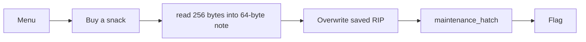

# Presentation review: Awakened Vending Machine writeup

This is a review of how the original `NOTES.md` was turned into a published post.
It is intentionally separate from the notes so the raw notes stay raw.

Published post:
`site/_posts/2026-11-27-tryhards-awakened-vending-machine.md`

## What worked well in the original notes

- The win function was identified immediately.
- `checksec` output was included and interpreted.
- The format string test was documented with real output.
- The source code was quoted next to the observation.
- The debugging session showed the stack layout and the crash.
- The offset was found with a cyclic pattern.
- The final flag was already censored.

That is a strong base. The main problem was presentation, not content.

## What was changed for the published post

The original wording was kept as-is. Only presentation and paths were changed.

1. **Converted the `'''` blocks into fenced code blocks** with `c`, `text`, and
   shell languages so the browser renders them cleanly.
2. **Added section headings** to break the notes into readable parts without
   rewriting the explanations.
3. **Preserved the original prose**, including the casual notes, typos, and
   debugging commentary.
4. **Collapsed the long stack dump and crash output** with `<details>` so the
   page is easier to scroll.
5. **Changed the path** `folder-kuwin` to `ctf` in the post and in
   `NOTES.md`.
6. **Attached the full source and disassembly** instead of pasting 16 KB of
   assembly into the post.
7. **Added an Attachments section** with links to:
   - `vending.c`
   - `text_section.txt`

## Suggested structure for a future revision

The current post intentionally keeps the original flow. If you want to make a
more polished version later, this structure works well:

```text
Challenge overview
TL;DR
Initial analysis
  - Hidden win function
  - Binary protections
Program behavior
Vulnerability discovery
  - Format string lead
  - Source analysis
  - Stack overflow
Debugging
Exploit
  - Offset
  - Payload layout
  - Result
Lessons learned
Attachments / references
```

## Optional improvements

These are not in the current post because you asked to keep the original text.
They are proposals for a later version.

### 1. Add a short challenge overview table

```markdown
| Field | Value |
| --- | --- |
| Platform | TryHards |
| Category | Pwn |
| Binary | vending |
| Protections | Partial RELRO, No canary, NX enabled, No PIE |
| Key bug | Stack buffer overflow |
```

### 2. Add a TL;DR

```markdown
- `maintenance_hatch()` prints the flag.
- `read()` writes 256 bytes into a 64-byte note buffer.
- No canary, offset to RIP is 168.
- Redirect execution to `maintenance_hatch()`.
```

### 3. Add a root-cause callout

```markdown
> The root cause is `read(STDIN_FILENO, note, 256)` writing up to 256 bytes into
> a 64-byte stack buffer. With no canary, the saved return address is reachable.
{: .prompt-info }
```

### 4. Explain the payload construction

```python
payload = b"A" * 168
payload += p64(win_address)
```

Only publish the actual address if it is safe to do so.

### 5. Add a “what I would try next” note

For example:

- test the format string leak more systematically,
- confirm whether the leak is stable enough for a GOT overwrite,
- compare the ret2win path with a libc-based approach.

### 6. Add a diagram



### 7. Add a “Lessons learned” section

- No PIE plus no canary is a strong hint toward a return-address overwrite.
- A format string can be a useful lead, but it is not always the final bug.
- Hidden win functions make ret2win simple when PIE is disabled.

## What not to change

- Do not publish the real flag.
- Do not publish a solver if the challenge is still active and the platform
  forbids it.
- Do not add screenshots of code; text is better.
- Do not remove the failed format string path. It is part of the learning story.
- Keep the original wording in the main post unless you deliberately want a
  polished rewrite.

## Bottom line

The post now matches the original notes closely, with cleaner formatting and
attachments. The next step in quality would be an optional polished version with
a short overview, root-cause callout, and payload explanation.
