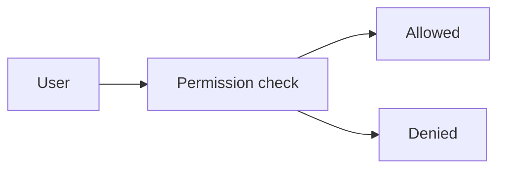

## What you will learn

By the end of this post you will be able to:

- explain the concept in plain language,
- recognize it in a real system,
- use it safely in a lab,
- avoid the most common mistakes.

## Prerequisites

- Basic Linux command line
- Familiarity with file permissions

## The mental model

Explain the concept before showing commands. Use an analogy or a simple diagram
if it helps.



## A worked example

Walk through one concrete example from start to finish.

```bash
# Example command
```

Explain what the command does and what the reader should notice in the output.

```text
Example output
```

## Why it matters

Connect the concept to a real scenario: a misconfiguration, a privilege
escalation path, a debugging technique, or a defensive control.

## Common pitfalls

- Pitfall 1 — what beginners do and why it fails.
- Pitfall 2 — a subtle assumption that is not always true.
- Pitfall 3 — a version or platform difference.

## Practice

Give the reader a safe exercise. Prefer a local lab, a deliberately vulnerable
application, or a retired box.

> Only practice on systems you own or have permission to test.
{: .prompt-warning }

## Further reading

- [Official documentation](https://example.com)
- [Related writeup](/posts/related-post/)
- [Tool reference](https://example.com)

## Summary

Restate the key idea in two or three sentences. End with what the reader should
try next.
